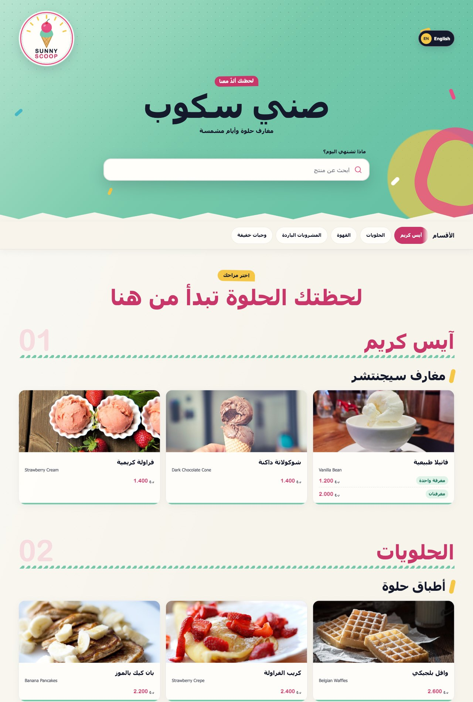
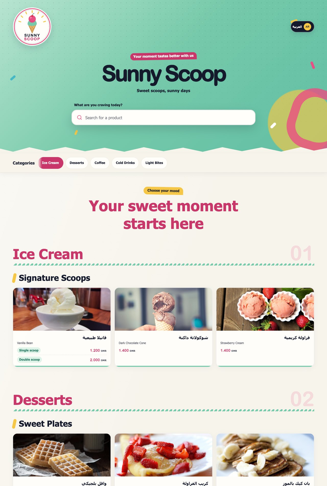
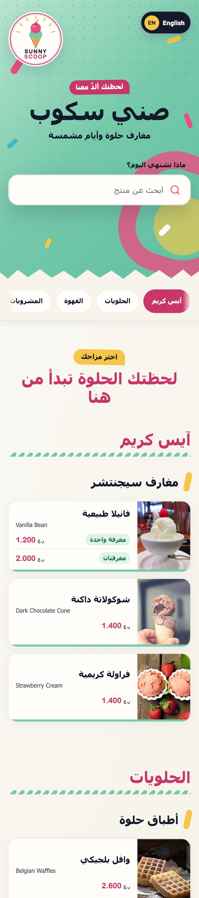
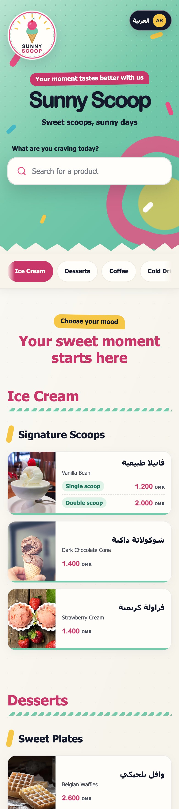

# Sunny Scoop — Digital Menu

A fast, dependency-free, bilingual (Arabic / English, RTL-aware) digital menu for ice-cream
shops and cafés. Plain HTML, CSS and JavaScript — no build step, no framework.

"Sunny Scoop" and all products are **sample data**; swap in your own.

**Live demo:** <https://w7orld.github.io/sunny-scoop-menu/> ([English](https://w7orld.github.io/sunny-scoop-menu/?lang=en))

## Screenshots

**Desktop** — Arabic (RTL, default) and English

| Arabic | English |
| --- | --- |
|  |  |

**Mobile** (390 px wide, fully responsive)

| Arabic | English |
| --- | --- |
|  |  |

## Features

- Arabic (default) and English with one-tap language switch
- Category bar with scroll-spy, product cards with photos
- Instant search (Arabic-normalised, aliases supported) with keyboard navigation
- Size / quantity price variants per product
- Mobile-first, accessible (skip link, ARIA labels, reduced-motion aware)

## Run it

Any static file server works:

```bash
python3 -m http.server 8000
```

then open <http://localhost:8000> (add `?lang=en` for English). (Opening `index.html` directly won't work because the menu
is loaded with `fetch`.)

## Customize

| What | Where |
| --- | --- |
| Brand name and tagline | `data/products.json` → `brand` |
| Phone and social accounts (`instagram`, `tiktok`, `snapchat`, `x`, `whatsapp`, `facebook`) | `data/products.json` → `contact`. Links set to `"#"` are placeholders — put your real profile URL in `url` |
| Branch locations (Google Maps links) | `data/products.json` → `locations` |
| Categories, products, prices | `data/products.json` → `sections[].families[].products[]` |
| Product photo | `image` field on each product (path under `assets/products/`) |
| Price variants (sizes, cups…) | repeat a product with the same names and a different `size` + `price` — they merge into one card |
| Logo and favicon | `assets/brand/` (`sunny-scoop-logo.svg` is the editable source) |
| UI text and currency | `TRANSLATIONS` in `assets/js/app.js` and the footer in `index.html` |
| Colors and fonts | CSS variables at the top of `assets/css/styles.css` |

Minimal product entry:

```json
{
  "id": "vanilla-bean-single",
  "nameAr": "فانيلا طبيعية",
  "nameEn": "Vanilla Bean",
  "price": "1.200",
  "image": "assets/products/vanilla-scoop.jpg",
  "aliases": ["vanilla"],
  "size": { "ar": "مغرفة واحدة", "en": "Single scoop" }
}
```

## License

Code: [MIT](LICENSE). Product photos are CC0 — see [CREDITS.md](CREDITS.md).
